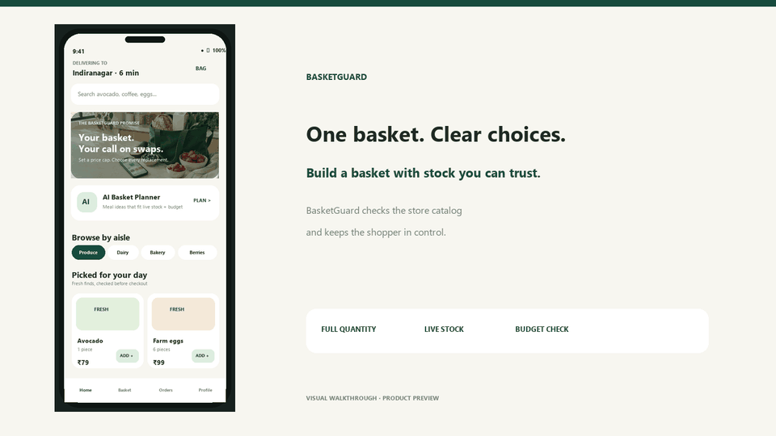

# BasketGuard

[](https://github.com/chaitanya-maddala-236/BasketGuard/actions/workflows/android-build.yml)

**A quick-commerce Android app for a problem every grocery shopper recognizes: an item goes out of stock after checkout starts.** BasketGuard checks current stock, suggests same-use replacements within a shopper-set price cap, and leaves the final choice to the shopper. Its AI Basket Planner turns a meal request and budget into a basket from the live catalog, with the server checking every item, quantity, and total before it reaches the app.

> Independent portfolio project inspired by quick-commerce services. Not affiliated with Blinkit.

**Kotlin · Jetpack Compose · Kotlin Multiplatform · StateFlow · FastAPI · OpenAI Responses API · PostgreSQL · Room · Firebase Analytics · Docker**

## 12-second product walkthrough

[](docs/media/basketguard-walkthrough.mp4)

[Watch or download the MP4](docs/media/basketguard-walkthrough.mp4) · [See the full-size preview](docs/media/basketguard-preview.png)

*These are illustrative UI previews rendered from the project design, not screenshots captured from a running device. The Android build and backend are included in this repository.*

## Resume-ready highlights

- Built an end-to-end Android grocery-shopping app with Compose, MVVM, `StateFlow`, Hilt, Room, Retrofit, and WorkManager, backed by a FastAPI service and PostgreSQL.
- Designed **Basket Rescue** for inventory changes at checkout: matches same-use products, checks the full requested quantity and a saved **0%, 15%, or 30%** price-increase cap, then lets the shopper swap, keep available units, or remove the item.
- Added an **AI Basket Planner** using OpenAI structured output. It plans from the store catalog and requested budget; the API verifies returned product IDs, quantity, live stock, and the recomputed total before accepting the plan.
- Separated shared product, basket-rescue, and planning rules into a **Kotlin Multiplatform domain module** with Android and iOS targets. The Android app consumes the shared module; this repository does not include an iOS app UI.
- Added optional **Firebase Analytics** events for AI planning and basket-rescue actions. Firebase activates only when a project-specific `google-services.json` is supplied; no Firebase credentials are committed.
- Added **7 Android unit tests** and **12 backend integration tests**, plus CI jobs for Android unit tests, APK assembly, and the backend suite.

### Project scope in numbers

| Measure | Implemented |
|---|---:|
| Demo catalog | 14 products across 7 aisles |
| REST API | 20 routes |
| Database | 12 SQLAlchemy models |
| Shopper swap caps | 3: 0%, +15%, +30% |
| Alternatives | Up to 5 per item, filtered by stock and quantity |
| Automated tests | 7 Android unit tests · 12 backend integration tests |

These are counts from the implementation, not production usage or measured business impact. The backend suite passes locally. Android unit tests and APK assembly run in GitHub Actions; check the workflow badge for the latest result.

## Get the app

**[Download the latest debug APK from GitHub Releases](https://github.com/chaitanya-maddala-236/BasketGuard/releases/latest/download/basketguard-debug.apk)** · [Browse all releases](https://github.com/chaitanya-maddala-236/BasketGuard/releases)

The APK is a CI-built debug build for review and sideloading, not a Play Store publication. The first install may require enabling installs from your chosen file source in Android settings.

## What makes it useful

Quick-commerce inventory can change while a basket is being checked out. A generic “item unavailable” message pushes the shopper to start over, while an automatic replacement can surprise them on price, size, or purpose. BasketGuard treats the stockout as a small decision flow:

1. Validate the basket against the store's current inventory.
2. If an item changed, find alternatives from its substitution group.
3. Filter candidates by store, full requested quantity, and the shopper's saved price cap.
4. Let the shopper choose a swap, keep the remaining available units, or remove the item.
5. Revalidate before placing the order; checkout uses transactional inventory updates and idempotency protection.

The demo catalog includes sold-out wild blueberries. Browse **Berries** and tap **Find swap** to compare candidates under each price cap. Checkout also brings up rescue choices if stock changed after the item entered the basket.

The AI planner addresses a second everyday need: “What can I make within this budget with what's actually available?” The model receives the request and current catalog, but the API treats model output as untrusted input and independently checks the items and total. Configure an OpenAI API key to use live planning; no key is needed for the rest of the demo app or test suite.

## Architecture and stack

- **Android app:** Kotlin, Jetpack Compose, MVVM, `StateFlow`, Hilt, Room, DataStore, Retrofit, WorkManager
- **Shared domain:** Kotlin Multiplatform module with common models and basket-planning/rescue rules; Android and iOS target configuration
- **Backend:** Python, FastAPI, Pydantic, SQLAlchemy, JWT authentication, OpenAI Python SDK / Responses API
- **Storage and local development:** PostgreSQL, SQLite, Docker Compose
- **Analytics:** Firebase Analytics adapter with a no-op fallback when Firebase is not configured
- **Verification:** JUnit, pytest, FastAPI `TestClient`, GitHub Actions

The OpenAI key stays on the backend. In tests, the model provider is stubbed; live model behavior requires your own configured API key and is not represented as a measured result.

## Run locally

### Start the API and PostgreSQL

From the repository root:

```powershell
docker compose up --build
```

The API seeds the demo store and catalog on startup. Explore endpoints at [http://127.0.0.1:8000/docs](http://127.0.0.1:8000/docs).

For live AI basket planning, copy `.env.example` to `.env`, set `OPENAI_API_KEY` in `.env`, then start the stack. Keep the key private; `.env` is ignored by Git. Without a key, other backend features still work and the AI route reports that planning is unavailable.

To run the API with local SQLite instead:

```powershell
cd backend
python -m venv .venv
.\.venv\Scripts\Activate.ps1
pip install -r requirements.txt
uvicorn app.main:app --reload
```

### Launch Android

Open the `android` directory in Android Studio, let Gradle sync, and run the `app` configuration on an emulator. The default API URL, `http://10.0.2.2:8000/api/v1/`, connects the emulator to the host machine. Android 8.0 (API 26) and newer is the minimum configured version.

Build a debug APK with JDK 17:

```powershell
cd android
.\gradlew.bat :app:assembleDebug
```

To enable Firebase Analytics, add your own Firebase Android app and put its `google-services.json` at `android/app/google-services.json`. That local config is ignored by Git. Without it, analytics safely no-ops.

### Run tests

```powershell
cd android
.\gradlew.bat :app:testDebugUnitTest

cd ..\backend
pip install -r requirements-dev.txt
python -m pytest -q
```

## Repository layout

```text
android/app/               Compose Android app, data layer, analytics, and unit tests
android/shared/            KMP shared domain models and business rules
backend/app/               FastAPI service, data models, and AI planner
backend/tests/             Inventory, checkout, AI validation, and substitution tests
docs/media/                README preview images and short product walkthrough
docs/                      Product brief, architecture, schema, and API design
docker-compose.yml         PostgreSQL and API for local development
```

## Current scope

Payments are mocked and order tracking uses a basic status model. The API initializes tables at startup for this portfolio project; production deployment would need versioned Alembic migrations, real payment integration, push notifications, and operational store-inventory tooling. This is an independent portfolio app, not a Blinkit integration or a published Play Store app.
